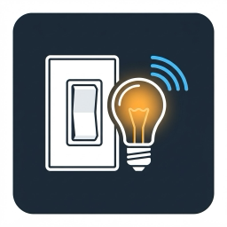

<p align="center">
  
</p>

# Smart Bulb Management

[](https://hacs.xyz/)
[](https://www.home-assistant.io/)
[](https://github.com/bisman-automations/ha-smartbulb-mgmt/releases)
[](https://github.com/bisman-automations/ha-smartbulb-mgmt/actions/workflows/test.yml)
[](https://github.com/bisman-automations/ha-smartbulb-mgmt/actions/workflows/validate.yml)
[](LICENSE)

Makes a switch or dimmer in **Smart Bulb Mode** and the smart bulbs it powers act as one light. Press the switch and the bulbs follow; change the bulbs from Home Assistant, an app or an automation and the switch shows it too. It works alongside **Holiday Lighting**, so a holiday show isn't overwritten when someone presses the switch.

## Requirements

- Home Assistant 2026.3 or newer.
- A switch or dimmer set to Smart Bulb Mode (it stays powered and only reports presses), and the smart bulbs it powers, both already in Home Assistant.
- Optional: [Holiday Lighting](https://github.com/bisman-automations/ha-holiday-lighting).

## Installation

### Marketplace (Home Assistant 2026.11 and newer, recommended)

[](https://my.home-assistant.io/redirect/marketplace_repository/?owner=bisman-automations&repository=ha-smartbulb-mgmt&category=integration)

1. Open the Marketplace and search for **Smart Bulb Management**, or select the button above to open this repository in the Marketplace.
2. Download **Smart Bulb Management** and restart Home Assistant.

New versions show up under **Settings > Updates**. Already installed Smart Bulb Management with
HACS? There's nothing to do: Home Assistant moves it into the Marketplace the
first time it starts on 2026.11.

### HACS (Home Assistant 2026.10 and older)

[](https://my.home-assistant.io/redirect/hacs_repository/?owner=bisman-automations&repository=ha-smartbulb-mgmt&category=integration)

1. Open HACS and search for **Smart Bulb Management**, or select the button above to open this repository in HACS.
2. Download **Smart Bulb Management** and restart Home Assistant.

### Custom repository

If **Smart Bulb Management** does not appear in search:

1. In HACS open the menu, choose **Custom repositories**, and add `https://github.com/bisman-automations/ha-smartbulb-mgmt` as an **Integration**.
2. Download **Smart Bulb Management** and restart Home Assistant.

### Manual

1. Download `smartbulb_mgmt.zip` from the [latest release](https://github.com/bisman-automations/ha-smartbulb-mgmt/releases/latest).
2. Unzip it into `config/custom_components/smartbulb_mgmt/` and restart Home Assistant.

## Setup

[](https://my.home-assistant.io/redirect/config_flow_start/?domain=smartbulb_mgmt)

Select the button above, or go to **Settings > Devices & services > Add
integration** and search for **Smart Bulb Management**.

## How it works

- **Switch to bulbs.** Turning the switch on turns the bulbs on; turning it off turns them off. With a dimmer, its brightness is passed to the bulbs (**Mirror dimmer brightness to bulbs**).
- **Bulbs to switch.** With **Two-way sync** on, when any bulb turns on (or all turn off) because of something else, the switch is updated to match. This never sends a command back to the bulbs.
- **Default color and brightness.** When the switch turns the bulbs on, it can set a default RGB color or color temperature and a brightness.
- **Holiday Lighting.** While the Holiday Lighting status is **On**, turning the switch on only switches on bulbs that are off and leaves the holiday colors alone, unless **Override holiday lighting** is on. Turning the switch off turns the bulbs off; with **Turn off Holiday Lighting control entity when switch turns Off**, it also turns off the Holiday Lighting switch you pick, so the show doesn't start again tonight.
- **Switch reconnecting.** If the switch drops off the network and comes back, nothing happens to the bulbs: only real presses count.

## Changing settings

- **Configure** (on the entry): bulbs, Holiday Lighting entities, sync, color and brightness.
- **Reconfigure** (in the entry's menu): choose a different switch or dimmer for the same bulbs.

## Repairs

If the switch or one of the bulbs is deleted or renamed, a repair under **Settings > System > Repairs** names it. Pick the switch again with **Reconfigure**, or update the bulbs with **Configure**. The repair goes away by itself once that's done.

## Troubleshooting

- **Diagnostics:** on the integration's page, open the menu and choose
  **Download diagnostics**. Attach the file to an issue (check it first for
  anything you'd rather not share).
- **Debug logs:** on the integration's page choose **Enable debug logging**,
  reproduce the problem, then **Disable debug logging** to download the log.
- If a bulb doesn't change, check the log: a light command that fails (bulb offline, for example) is logged as a warning by Smart Bulb Management.
- Report problems at [Issues](https://github.com/bisman-automations/ha-smartbulb-mgmt/issues).

## Development

```
python3.14 -m venv .venv && . .venv/bin/activate
pip install -r requirements_test.txt
ruff check . && ruff format --check .
pytest
```

CI also tests the oldest supported Home Assistant (`requirements_test_min.txt`)
and runs hassfest and the HACS checks. Releases are drafted automatically from
`CHANGELOG.md` on every push to `main` and published by hand. See
[CLAUDE.md](CLAUDE.md) and [CONTRIBUTING](https://github.com/bisman-automations/.github/blob/main/CONTRIBUTING.md).

## License

[MIT](LICENSE)
